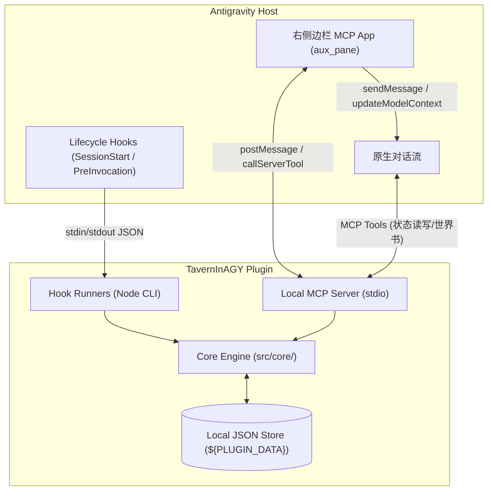

# TavernInAGY 项目级开发文档

> **项目定位**：基于 Antigravity 原生扩展体系（MCP Apps + Local MCP Server + Lifecycle Hooks + Skill）构建的轻量化 Roleplay 引擎，原生兼容 SillyTavern 社区的角色卡、世界书与预设生态。

---

## 1. 设计目标与合规边界

1. **100% 官方原生扩展路径**：
   - 不抓包、不抽取 OAuth 凭据、不搭建第三方反代接口。
   - 不使用 `Stop` / `PostInvocation` 无人死循环，仅响应真人用户输入。
2. **高保真兼容 SillyTavern 社区资产**：
   - 角色卡：PNG V2 (`chara`) / V3 (`ccv3`) 与 JSON 格式。
   - 世界书：World Info JSON（常驻条目、主/次关键词、正则、递归扫描、优先级与预算控制）。
   - 社区预设：Chat Completion Preset JSON（`prompts`、`prompt_order`、空内容分组标题、嵌套多行宏、`extensions.regex_scripts`）。
3. **适配 AGY 追加式上下文（Append-only Trajectory）**：
   - 通过 **分层注入 + 冷却去重（Cooldown Deduplication）**，做到“设定不漏掉、上下文不爆仓、主人零手动粘贴”。
4. **低维护解耦设计**：
   - 75% 核心逻辑位于零 AGY 依赖的 `src/core/`；AGY 适配代码隔离在极薄的 `src/agy/` 层。

---

## 2. 系统总体架构



### 三层上下文注入策略

| 层级 | 触发时机 | 注入内容 | 防爆仓机制 |
| :--- | :--- | :--- | :--- |
| **L1 静态核心层** | `SessionStart`（每会话仅 1 次） | 预设 `chatHistory` 之前启用条目（展开宏） + 角色卡本体 + 蓝灯常驻世界书 | 单次注入，绝不重复 |
| **L2 动态世界书层** | `PreInvocation`（每轮用户发言前） | 扫描最近 `scan_depth` 轮命中的绿灯世界书条目（支持递归与预算截断） | **冷却窗口（默认 12 轮）**：近期已注入条目自动跳过 |
| **L3 近因锚点层** | `PreInvocation`（按需/间隔刷新） | 预设 `chatHistory` 之后的规划/文风锚点 + 精简实时状态（时间/地点/好感/物品） | 状态未变更时跳过或按间隔精简刷新 |

---

## 3. 目录结构规划

```text
TavernInAGY/
├── docs/
│   └── DESIGN.md                     # 本文档
├── src/
│   ├── core/                         # 纯 TS 核心酒馆引擎（零宿主依赖）
│   │   ├── types.ts                  # 全量数据模型定义
│   │   ├── macro-engine.ts           # 栈式嵌套多行宏求值器
│   │   ├── card-parser.ts            # ST PNG (tEXt chara/ccv3) & JSON 解析器
│   │   ├── preset-parser.ts          # ST 预设解析、分组提取、静态/近因分层
│   │   ├── lorebook-engine.ts        # ST 世界书扫描 + 递归 + 预算 + 冷却去重
│   │   ├── prompt-assembler.ts       # 统一编排器（输出 L1/L2/L3 文本）
│   │   └── storage.ts                # 本地文件仓储（原子写入、会话状态隔离）
│   ├── agy/                          # AGY 适配层（薄隔离层）
│   │   ├── transcript-reader.ts      # 防御性解析 transcript.jsonl + 降级缓存
│   │   ├── hook-session-start.ts     # SessionStart 钩子可执行入口
│   │   ├── hook-pre-invocation.ts    # PreInvocation 钩子可执行入口
│   │   └── mcp-server.ts             # MCP Server & MCP App (ui://tavern/app.html)
│   └── ui/                           # MCP App 前端（React + Vite 单文件）
│       ├── index.html
│       ├── main.tsx
│       ├── App.tsx
│       └── styles.css
├── plugin/                           # Antigravity 插件模板
│   ├── plugin.json
│   ├── mcp_config.json
│   ├── hooks.json
│   ├── assets/logo.svg
│   └── skills/tavern-rp/SKILL.md
├── scripts/
│   ├── build-plugin.mjs              # 打包 dist/ 与插件产物
│   └── install-plugin.mjs            # 安装到 ~/.gemini/config/plugins/tavern-in-agy
└── tests/                            # Vitest 单元测试与真实样本集成测试
```

---

## 4. 核心模块技术契约

### 4.1 嵌套多行宏引擎 (`src/core/macro-engine.ts`)
- **解析算法**：基于 `{{` / `}}` 深度栈的**由内向外（innermost-first）**求值，完美支持多行 `setvar` 与嵌套宏（如 `{{setvar::a::...{{getvar::b}}...}}`）。
- **首批支持宏**：
  - 变量类：`{{setvar::k::v}}`（求值返回空串）、`{{getvar::k}}`、`{{addvar::k::delta}}`
  - 随机类：`{{random::a::b::...}}`（支持上千次高频调用，如 `wave-noise-anchor`）
  - 上下文类：`{{char}}`、`{{user}}`、`{{persona}}`、`{{scenario}}`、`{{time}}`、`{{date}}`
  - 工具类：`{{// 注释}}`（返回空串）、`{{trim}}`

### 4.2 角色卡解析器 (`src/core/card-parser.ts`)
- 支持 PNG 二进制流逐块扫描（跳过 8 字节 PNG Header，解析 `tEXt` chunk，优先读取 `ccv3`，回退 `chara`，Base64 UTF-8 解码）。
- 自动将角色卡 PNG 转为 `data:image/png;base64,...` 供侧边栏立绘展示（遵守 MCP App 默认 CSP）。
- 支持 Chara Card V1 / V2 (`spec: chara_card_v2`) / V3 (`spec: chara_card_v3`) 归一化为统一 `CharacterCard` 模型，并自动提取内嵌 `character_book`（角色自带世界书）。

### 4.3 社区预设解析器 (`src/core/preset-parser.ts`)
- 读取 `prompt_order`（优先 `character_id === 100001`，否则取最后一条），与 `prompts` 表按 `identifier` 关联。
- **空内容分组识别**：`content.trim() === '' && !marker` 的条目保留为 `section` 分组节点，供侧边栏渲染可折叠手风琴。
- **静态/近因分层**：
  - 按顺序遍历所有启用条目并持续维护同一份 `MacroContext`（确保前半段 `setvar` 对后半段 `getvar` 生效）。
  - `chatHistory` 之前的有效渲染文本 + 8 个标准 `marker` 插槽 → `staticBlocks`（L1）。
  - `chatHistory` 之后或 `injection_position === 1` 的有效渲染文本 → `postHistoryBlocks`（L3）。
- 兼容保留 `extensions.regex_scripts` 列表（区分显示/发送正则，供侧边栏标签解析与清洗参考）。

### 4.4 世界书引擎 (`src/core/lorebook-engine.ts`)
- 支持 SillyTavern World Info JSON（`entries` 对象或数组形式）及角色卡内嵌 `character_book`。
- 扫描流程：
  1. 提取 `constant: true` 的蓝灯常驻条目（L1 注入）；
  2. 取最近 `scanDepth` 轮对话文本，对绿灯条目匹配 `key`（支持普通子串与 `/regex/flags`）及 `keysecondary`（支持 `AND_ANY` / `NOT_ALL` / `NOT_ANY` / `AND_ALL`）；
  3. 开启 `recursive` 时，将命中条目正文拼入扫描缓冲执行递归（受 `maxRecursionSteps` 限制防死循环）；
  4. 按 `order` 降序排序，按 `tokenBudget`（按字符估算）截断；
  5. 过滤掉在当前会话 `cooldownTurns` 轮内已注入过的条目，并更新会话注入记录。

### 4.5 AGY Hooks 与 MCP Server (`src/agy/`)
- **`SessionStart`**：仅当配置中 `enabled === true` 且已选定激活角色时生效；注入 L1 静态包并初始化会话状态。
- **`PreInvocation`**：
  - 通过 `conversationId + lastUserInput` 去重（防止同一回合内多次模型调用重复触发）；
  - 防御性读取 `transcriptPath` 最近消息并合并本地缓存；
  - 执行 L2 世界书扫描 + L3 近因锚点组装，若非空则通过 `injectSteps` 注入 `systemMessage`。
- **MCP Server 工具**：
  - 模型可见工具：`tavern_get_state`、`tavern_update_state`、`tavern_search_lorebook`、`tavern_save_snapshot`
  - 仅 App 可见工具（`visibility: ["app"]`）：`tavern_app_bootstrap`、`tavern_app_import_card`、`tavern_app_import_preset`、`tavern_app_import_lorebook`、`tavern_app_toggle_preset_prompt`、`tavern_app_select_active`、`tavern_app_update_config`、`tavern_app_delete_asset`
  - 侧边栏入口工具：`tavern_open_panel`（声明 `ui.resourceUri = "ui://tavern/app.html"` 与 `aux_pane` / `global` entrypoints）。

---

## 5. 里程碑与版本控制规范

### 里程碑划分
- **M1（v0.1.0）核心引擎与测试**：完成 `src/core/` 全部模块，并通过单元测试及真实社区预设 `我即浪潮` 集成验证。
- **M2（v0.2.0）AGY 适配层与插件骨架**：完成 `src/agy/`（Hooks + MCP Server）与 `plugin/` 配置，打通命令行端到端冒烟测试。
- **M3（v0.3.0）侧边栏 MCP App UI 与一键安装**：完成 React 单文件侧边栏控制台（角色卡、预设手风琴开关、世界书、实时状态栏与快捷选项按钮）及插件安装脚本。

### Git 版本控制规范
- 使用语义化提交信息（Conventional Commits）：
  - `docs: ...` / `chore: ...` / `feat(core): ...` / `feat(agy): ...` / `feat(ui): ...` / `test: ...`
- 每个里程碑完成后打独立 Git Tag（`v0.1.0`、`v0.2.0`、`v0.3.0`）。
- 用户个人隐私角色卡与社区预设文件通过 `.gitignore` 隔离，不提交至版本库。
